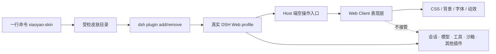

# 夕小瑶 × DeepSeek Harness 皮肤工坊

一套面向真实 DeepSeek Harness Web profile 的社区皮肤合集。不是静态仿站，也不替换
会话、模型、工具、沙箱或插件系统；每套皮肤都是一个可安装、可卸载、可测试的 DSH
表现层插件。

[](https://github.com/147228/dsh-xiaoyao-skins/actions/workflows/ci.yml)
[](https://147228.github.io/dsh-xiaoyao-skins/)
[](https://www.npmjs.com/package/@deepseek-ai/dsh)

## 一行换肤

需要 Node.js 24+，并已安装、初始化 DeepSeek Harness。命令默认操作 `web` profile。

```bash
npx --yes --package=https://github.com/147228/dsh-xiaoyao-skins/releases/latest/download/xiaoyao-skin-kit.tgz xiaoyao-skin use black-whale
```

切换另一套皮肤：

```bash
npx --yes --package=https://github.com/147228/dsh-xiaoyao-skins/releases/latest/download/xiaoyao-skin-kit.tgz xiaoyao-skin use ocean
```

恢复官方界面：

```bash
npx --yes --package=https://github.com/147228/dsh-xiaoyao-skins/releases/latest/download/xiaoyao-skin-kit.tgz xiaoyao-skin use official
```

可用 `--profile <name>` 指定其他 profile，用 `--dry-run` 只查看将执行的 DSH 命令。

## 首发皮肤

| 皮肤 | 视觉方向 | 命令 |
| --- | --- | --- |
| [黑鲸实验室](packages/skins/black-whale) | 官网黑鲸 × 石墨黑 × 小瑶粉 | `use black-whale` |
| [探索之境](packages/skins/ocean) | 深海蓝 × 猫娘粉 × 鲸鱼光效 | `use ocean` |
| [晴空研究所](packages/skins/sky-lab) | 云端白昼 × 双主角协作 | `use sky-lab` |
| [烽火夜长城](packages/skins/great-wall-beacon) | 炭黑长城 × 中国红 × 古金 | `use great-wall-beacon` |
| [山河朝霞](packages/skins/great-wall-sunrise) | 米白宣纸 × 朱红 × 朝霞金 | `use great-wall-sunrise` |
| [雪岭长城](packages/skins/great-wall-snow) | 雪白 × 墨灰 × 正红披风 | `use great-wall-snow` |

全部预览与可复制命令见 [在线皮肤展厅](https://147228.github.io/dsh-xiaoyao-skins/)。

## 为什么不影响 DSH 其他功能



安装器遵守三个边界：

1. 先通过官方 `dsh plugin add` 安装目标皮肤；
2. 切换时只移除本仓库登记过的其他皮肤包；
3. 不改 DSH 源码，不清空 profile，不读取或迁移会话数据。

皮肤本身必须只做表现层工作，运行时禁止发起网络请求，也禁止导入功能型 DSH
服务。具体约束见 [皮肤规范](docs/SKIN_SPEC.md) 和 [技术架构](docs/ARCHITECTURE.md)。

## 做一套自己的皮肤

```bash
npx --yes --package=https://github.com/147228/dsh-xiaoyao-skins/releases/latest/download/xiaoyao-skin-kit.tgz xiaoyao-skin create moon-rabbit
cd dsh-skin-moon-rabbit
pnpm install
pnpm check
```

模板已经带好官方 DSH bundle 接线、Web client 入口、可逆卸载、CSS 隔离、测试和
授权文件。做好后运行合集医生：

```bash
npx --yes --package=https://github.com/147228/dsh-xiaoyao-skins/releases/latest/download/xiaoyao-skin-kit.tgz xiaoyao-skin doctor ./dsh-skin-moon-rabbit
```

然后从 [皮肤提案](https://github.com/147228/dsh-xiaoyao-skins/issues/new?template=skin_proposal.yml)
开始，或直接阅读 [贡献指南](CONTRIBUTING.md)。

## 本地开发

```bash
corepack enable
pnpm install --frozen-lockfile
pnpm check
pnpm pack:release
```

`pnpm check` 会校验目录元数据、官方 DSH 接线、表现层权限边界、生命周期清理、
六套皮肤单测、安装器单测、构建结果与展厅。合并请求还会在 Linux、macOS、Windows
三套环境中重跑。

## 许可与声明

- 代码：MIT；
- 夕小瑶角色、美术和预览素材：默认按 [CC BY-NC 4.0](ASSET_LICENSE.md)；
- 第三方素材与例外：见 [THIRD_PARTY_NOTICES.md](THIRD_PARTY_NOTICES.md)；
- 本项目为社区项目，不是 DeepSeek 官方产品。DeepSeek、DeepSeek Harness 及相关标识
  的权利归各自权利人所有。
