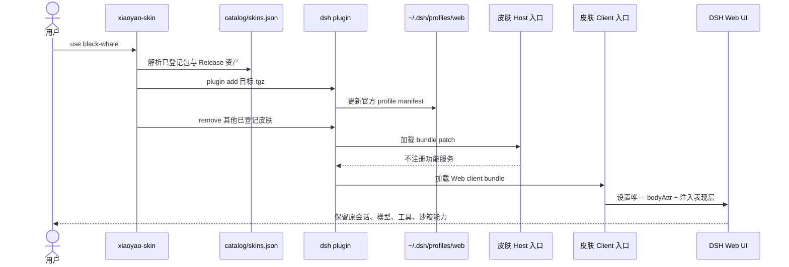

# 技术架构

## 目标

这个仓库解决两件事：一是让普通用户用一条命令切换皮肤；二是让创作者在不碰 DSH
功能内核的前提下制作、测试和提交表现层插件。

## 运行链路

安装顺序刻意采用“先加目标、后移旧皮肤”。如果目标下载或安装失败，旧皮肤仍在，
不会把用户留在半配置状态。

## 仓库分层

- `packages/skins/*`：每套皮肤独立的 DSH bundle；
- `catalog/skins.json`：由 `skin.json` 生成的唯一发行目录；
- `bin/xiaoyao-skin.mjs`：安装、切换、回退、创建与体检命令；
- `templates/skin`：独立创作者模板；
- `scripts/validate-skins.mjs`：权限与结构边界检查；
- `gallery` / `site`：展厅源码与 GitHub Pages 构建产物；
- `release/*.tgz`：标签发布时生成的稳定安装资产。

## 能力边界

皮肤可以：

- 通过 CSS 变量、CSS Module 和受控 DOM 属性改变色彩、排版、背景、边框与动效；
- 使用仓库内有许可的图片和字体；
- 读取视口、系统配色和 reduced-motion 等纯表现层能力。

皮肤不可以：

- 替换或代理会话、模型、工具、沙箱、存储、网络请求；
- 采集遥测、上传 profile 内容或注入外部脚本；
- 直接改写 DSH 安装目录、用户配置或其他插件；
- 用全局选择器污染未启用皮肤时的页面。

## 可逆生命周期

Client 入口用 `ctx.effect()` 安装皮肤，并返回清理函数。卸载或热重载时必须移除
`bodyAttr`、事件监听与运行期 style 节点。测试会真实执行 `dispose()`，避免“换完皮肤
回不去”的残留状态。
